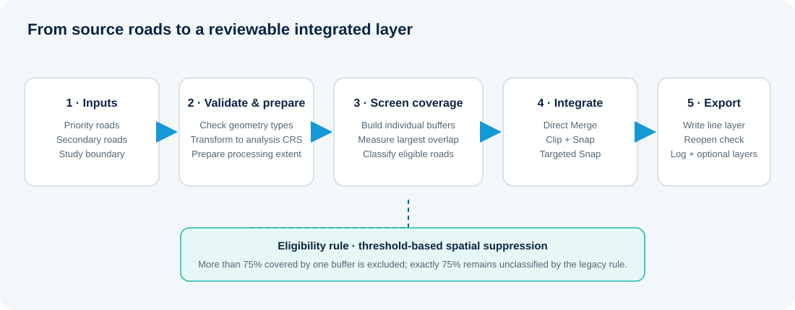
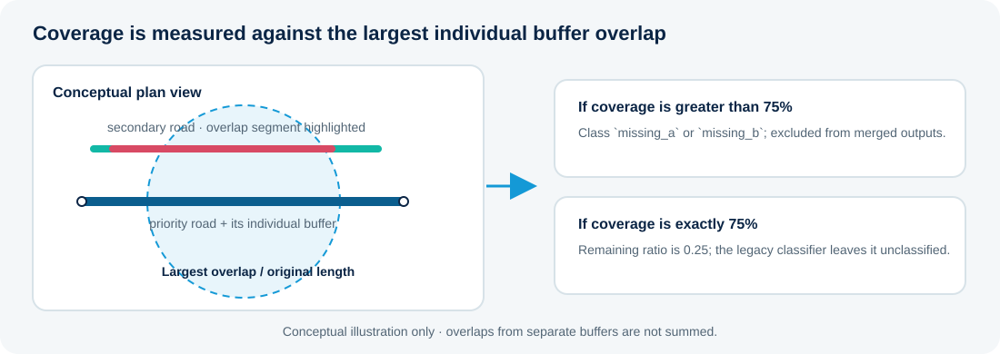
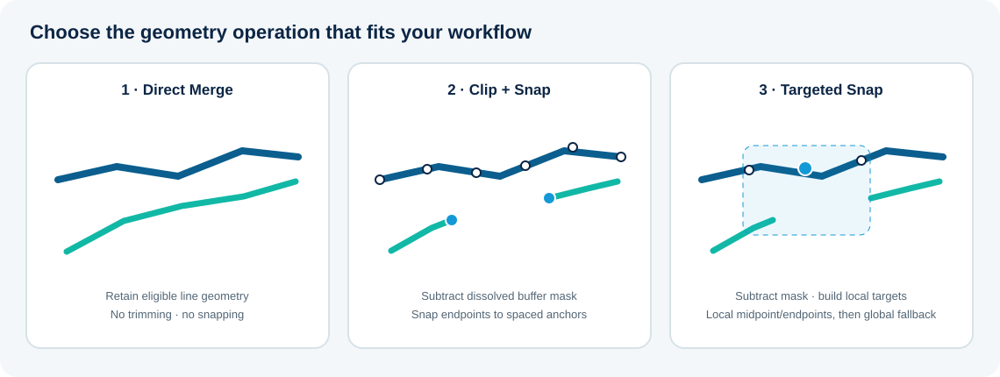
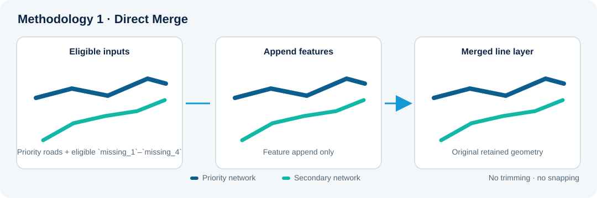
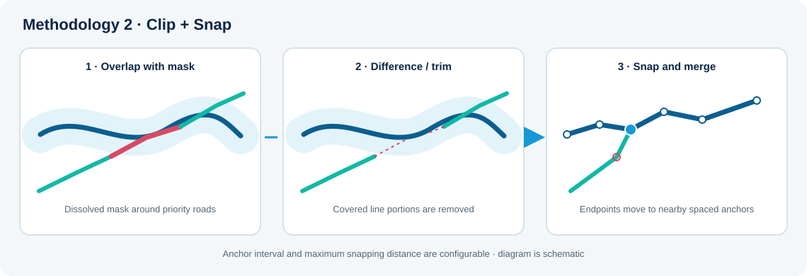
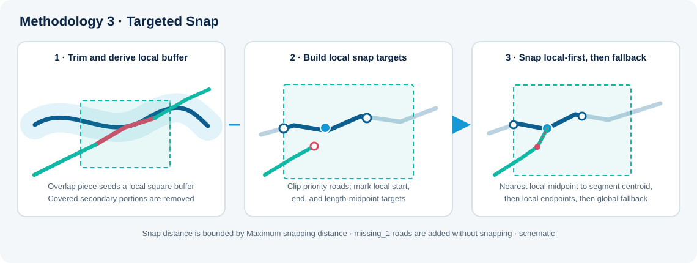

# Road Network Integration Toolkit

**Bring road networks together. Classify coverage. Choose how they connect.**

[Overview](#overview) · [Methodologies](#integration-methods) · [Documentation](help/methodology_guide.md) · [GitHub](https://github.com/martin-runguma/qgis-road-network-integration-toolkit) · [Get the plugin](https://plugins.qgis.org/plugins/road_network_integration_toolkit/)

The Road Network Integration Toolkit is a QGIS plugin for combining a trusted priority road network with useful roads from a secondary dataset. It measures how much of each secondary road is covered by priority-road buffers, classifies candidate roads, and applies one of three integration methods.


<p align="center">
  <a href="https://plugins.qgis.org/plugins/road_network_integration_toolkit/"></a>
  
  
  <a href="LICENSE"></a>
</p>

<p align="center">
  <a href="https://plugins.qgis.org/plugins/road_network_integration_toolkit/">Install from the QGIS Plugin Repository</a> ·
  <a href="help/methodology_guide.md">Methodology guide</a> ·
  <a href="https://github.com/martin-runguma/qgis-road-network-integration-toolkit">Source code</a> ·
  <a href="https://github.com/martin-runguma/qgis-road-network-integration-toolkit/issues">Report an issue</a>
</p>

## Contents

- [Overview](#overview)
- [Capabilities](#capabilities)
- [Workflow](#workflow)
- [Coverage classification](#coverage-classification)
- [Integration methods](#integration-methods)
- [Installation](#installation)
- [Quick start](#quick-start)
- [Outputs and data formats](#outputs-and-data-formats)
- [Technical notes](#technical-notes)
- [Troubleshooting](#troubleshooting)
- [Development and contributing](#development-and-contributing)
- [Project links](#project-links)

## Overview

Road datasets often differ in coverage and geometry. One network may be authoritative for the main road structure, while another contains useful streets that are absent from it. Combining the two without a clear rule can leave duplicate coverage, gaps, or disconnected endpoints.

The toolkit gives GIS analysts, transport planners, researchers, and geospatial developers a repeatable way to screen and integrate two line networks inside a study area. The priority network is retained as the reference. Eligible secondary roads are added directly, trimmed against priority-road buffers, or trimmed and locally snapped, depending on the selected method.

The plugin runs within QGIS using its vector, geometry, coordinate transformation, and file-writing APIs. It does not require separately installed GeoPandas or Shapely packages.

## Capabilities

| Capability | What it does |
|---|---|
| **Coverage classification** | Measures overlap against individual priority-road buffers and assigns the legacy `Missing_Class` categories to secondary roads. |
| **Three integration methods** | Offers Direct Merge, Clip + Snap, and Targeted Snap, with different trimming and endpoint-alignment behavior. |
| **Input checks and CRS handling** | Checks the selected line and polygon layers, validates a projected analysis CRS, and converts metre-based settings to its map units. |
| **Background processing** | Runs the integration as a QGIS background task with progress reporting, a live log, and cancellation at safe checkpoints. |
| **Reviewable diagnostics** | Can retain coverage, priority-buffer, and method-specific intermediate layers, plus a timestamped processing log. |
| **Multiple output drivers** | Writes the final multiline road layer to GeoPackage, Shapefile, or a File Geodatabase when the installed GDAL driver can create one. |

## Workflow



1. **Select inputs.** Choose priority roads, secondary roads, and a polygon study-area boundary.
2. **Prepare geometry.** The engine transforms roads to the analysis CRS and limits processing to the envelope of a 30 km buffer around the study boundary.
3. **Measure coverage.** Individual flat-ended buffers are created around priority-road features. Each secondary road is classified using its largest overlap with one individual buffer.
4. **Apply a method.** The selected method retains eligible secondary roads as-is, subtracts the dissolved priority-buffer mask, or subtracts the mask and snaps line endpoints.
5. **Write and review.** The final multiline layer is exported and reopened for a readability check. A processing log is written beside it; intermediate layers are optional.

## Coverage classification

The screening stage uses a **dominant single-buffer coverage** measure. If one individual priority buffer fully covers a secondary road, that road is classified as `missing_a`. Otherwise, the engine calculates the intersection length with each intersecting individual buffer and uses the largest overlap; it does not add overlap lengths from separate buffers.

The remaining-length ratio is:

```text
remaining-length ratio = (original length − largest single-buffer overlap) / original length
```



The ratio drives the legacy classification and determines which secondary features are eligible for merged outputs:

| Remaining-length ratio | Coverage interpretation | Class | Included in merged output |
|---|---|---|---|
| `0` to `0.01` inclusive | At least 99% covered, or fully covered by one buffer | `missing_a` | No |
| Greater than `0.01` and less than `0.25` | More than 75% and less than 99% covered | `missing_b` | No |
| Exactly `0.25` | Exactly 75% covered | Unclassified | No |
| Greater than `0.25` through `0.50` | At least 50% and less than 75% covered | `missing_4` | Yes |
| Greater than `0.50` through `0.75` | At least 25% and less than 50% covered | `missing_3` | Yes |
| Greater than `0.75` and less than `1` | More than 0% and less than 25% covered | `missing_2` | Yes |
| Exactly `1` | No measured overlap | `missing_1` | Yes |

This eligibility rule can be described as **threshold-based spatial suppression**: roads with more than 75% coverage are excluded from all three merged outputs. The exact 75% boundary is also excluded because the legacy classifier leaves a remaining ratio of `0.25` unclassified. This is distinct from non-maximum suppression (NMS); the toolkit does not rank candidate roads by a confidence score.

Classification uses the largest overlap with one individual buffer. In Clip + Snap and Targeted Snap, trimming is a later operation against the **dissolved** priority-buffer mask. These measures answer different questions and should not be interpreted as the same coverage statistic.

## Integration methods



| Method | Main operations | Resulting behavior | Suitable when… |
|---|---|---|---|
| **1 · Direct Merge** | Keeps all priority roads and appends secondary roads in `missing_1`–`missing_4`. | Retained secondary geometries are not trimmed or snapped. Small gaps and crossings can remain. Output attributes are simplified to `coverage_ratio`, `Missing_Class`, and `source`. | A fast merge with original secondary geometry is preferred. |
| **2 · Clip + Snap** | Subtracts the dissolved priority-buffer mask from eligible secondary roads; creates regularly spaced anchors on priority roads; snaps each remaining line part's endpoints to the nearest anchor within the maximum snapping distance. | Covered portions are removed and nearby endpoints can be moved. Progressive merges are also written to the method's intermediate GeoPackage when intermediates are retained. | Roads should be trimmed and connected to nearby points along the priority network. |
| **3 · Targeted Snap** | Subtracts the dissolved mask; square-buffers secondary-road overlap portions; clips priority roads to those local buffers; derives local start, end, and midpoint targets. | Tries the nearest local midpoint to the secondary segment's centroid, then local endpoints, then global targets if earlier stages do not snap. Target checks use the maximum snapping distance. `missing_1` roads are added without snapping. | Joins should be guided by local overlap context. |

### Methodology 1 · Direct Merge



The workflow retains the priority network and appends secondary features classified as `missing_1` through `missing_4`. It does not trim secondary geometries or adjust their endpoints, so overlaps, crossings, or small gaps may remain. The output attributes are simplified to `coverage_ratio`, `Missing_Class`, and `source`.

### Methodology 2 · Clip + Snap



The engine subtracts the dissolved priority-buffer mask from eligible secondary roads. It then creates regularly spaced anchors along priority roads and snaps each remaining line-part endpoint to the nearest anchor within **Maximum snapping distance**. When intermediate outputs are retained, this method also writes progressive merges for `missing_1`, then `missing_1`–`missing_2`, and so on through `missing_4`.

### Methodology 3 · Targeted Snap



After subtracting the dissolved mask, the method square-buffers the overlap portions of secondary roads and clips priority roads to those local buffers. For each eligible trimmed segment other than `missing_1`, it tries the nearest local midpoint to the segment centroid, then local endpoints, and finally global targets. Each snap is bounded by **Maximum snapping distance**; `missing_1` roads are added without snapping. The dialog's **Maximum centroid adjustment distance** setting is currently validated but not used by the engine.

These illustrations summarize the plugin's shared QGIS geometry workflow. They are schematic and do not represent measured output from a particular road dataset. Methodology 3 also differs from the original standalone legacy script: the plugin restores the association between trimmed secondary roads and their local buffers before snapping.

## Installation

### QGIS Plugin Manager

1. In QGIS, open **Plugins → Manage and Install Plugins…**.
2. Search for **Road Network Integration Toolkit**.
3. Select the plugin and choose **Install Plugin**.
4. Open it from the **Plugins** menu or its toolbar icon.

The [official QGIS plugin page](https://plugins.qgis.org/plugins/road_network_integration_toolkit/) provides the listing and downloadable package. If you install from a downloaded package, use **Install from ZIP** in the Plugin Manager.

For a source install, place the repository's plugin files in a folder named `road_network_integration_toolkit` under the active QGIS profile's `python/plugins` directory. Restart QGIS and enable the plugin. For most users, installing through the Plugin Manager is simpler.

## Quick start

1. **Load or browse to the data.** Select line layers for **Priority road network (Path)** and **Secondary road network (Path)**, and a polygon layer for **Study area boundary (Polygon)**. For GeoPackage and File Geodatabase containers, choose the required feature layer.
2. **Choose the method.** Select **Merging methodology**: Direct Merge, Clip + Snap, or Targeted Snap. Targeted Snap is selected when the dialog opens.
3. **Set the analysis CRS.** Choose a suitable projected CRS for the study area. **Suggest from study area** can suggest a local UTM CRS; a projected CRS is required for distance operations.
4. **Review distances.** **Advanced settings** exposes the metre-based distances below. Keep the defaults for an initial run, then tune one setting at a time.
5. **Set the destination.** Choose **Output folder**, enter an **Output name / prefix**, and select **Output data type**. The plugin adds `_Road_Network_Harmonized` to the name.
6. **Validate and run.** Click **Validate Inputs**, correct any reported errors, then click **Run Integration**. Follow **Processing progress and log**. Use **Cancel Run** or the QGIS task manager to request cancellation at the next safe checkpoint.
7. **Review the result.** Read the completion message and `<output-name>_processing.log`. If requested, the plugin adds the final result to the QGIS project; turn on **Keep intermediate diagnostic layers** to retain analysis layers for inspection.

| Interface setting | Default | Used by |
|---|---:|---|
| Priority road buffer distance | 20 m | Coverage classification and priority-buffer mask |
| Secondary road buffer distance | 10 m | Local square buffers in Targeted Snap |
| Maximum snapping distance | 25 m | Endpoint snapping distance in Clip + Snap and Targeted Snap |
| Midpoint densification interval | 10 m | Anchor spacing in Clip + Snap |
| Maximum centroid adjustment distance | 15 m | Displayed and validated by the dialog, but currently not consumed by the processing engine |


## Outputs and data formats

The final output is a **multiline road layer** in the selected analysis CRS. Supported final formats are:

| Format | Notes |
|---|---|
| **GeoPackage (`.gpkg`)** | Recommended. Preserves full field names and supports the output layer and intermediate layers. |
| **Shapefile (`.shp`)** | Supported for compatibility; field names are limited to 10 characters and each layer is a separate file set. |
| **File Geodatabase (`.gdb`)** | Available only when the active QGIS/GDAL installation exposes a driver that can create a geodatabase. OpenFileGDB creation support is available in GDAL 3.6 and later; a FileGDB driver may also be available. |

For Direct Merge, the final layer contains `coverage_ratio`, `Missing_Class`, and `source`. Here `coverage_ratio` stores the rounded remaining-length ratio (0–1), not the complementary covered proportion. The other methods combine the prepared priority-road attributes with eligible secondary-road attributes and coverage fields. Source identifier fields such as `fid` are retained under safe names (for example, `source_fid`) where needed to avoid writer key collisions; stale geometry-derived fields are not copied as if they were current measurements.

The final file is written to the selected output folder and reopened as a readability check. Existing output paths may be overwritten. The processing log is timestamped and written beside the output. When **Keep intermediate diagnostic layers** is enabled, the plugin saves the priority buffers, classified secondary roads, and method-specific diagnostics.

| Intermediate dataset | Location | Contents |
|---|---|---|
| `<prefix>_<priority>_Road_Buffers.gpkg` | `Intermediate_Files/` | Individual and dissolved priority-road buffers |
| `<prefix>_<secondary>_Coverage_Classified.gpkg` | Output folder | Secondary roads with their `Missing_Class` and coverage attributes |
| `<prefix>_Merged_<priority>_<secondary>_Method1.gpkg` | `Intermediate_Files/` | Direct Merge result |
| `<prefix>_M2_Output.gpkg` | `Intermediate_Files/` | Clip + Snap diagnostic layers and progressive merges |
| `<prefix>_M3_Output.gpkg` | `Intermediate_Files/` | Targeted Snap diagnostic layers |

The `<prefix>` comes from the output name, and `<priority>` / `<secondary>` are labels inferred from the selected input sources.

## Technical notes

- **Runtime:** QGIS 3.28 through 4.99; the plugin declares Qt 6 support and uses compatibility helpers for QGIS/Qt API differences. Processing uses the Python, PyQGIS, Qt, and GDAL/OGR components supplied by the active QGIS installation; no separate GeoPandas or Shapely install is required.
- **Input geometry and formats:** road inputs must be line layers and the study boundary must be polygon geometry. The file picker includes Shapefile (`.shp`), GeoPackage (`.gpkg`), GeoJSON/JSON, GML, KML, MapInfo TAB/MIF, and DXF filters; it can also select sublayers from GeoPackage and File Geodatabase containers. Actual readability depends on the QGIS/GDAL providers installed on the system.
- **CRS and units:** the analysis CRS must be a valid projected CRS. Distance controls are entered in metres and converted to the selected CRS's map units. A local projected CRS is recommended to limit distortion.
- **Processing extent:** input roads are prepared within the envelope of the study boundary expanded by 30 km; they are not clipped to the study polygon itself.
- **Background work:** geometry processing runs in a `QgsTask`; project-layer access and result loading are handled on QGIS's main thread. Cancellation occurs at safe checkpoints, so it may not interrupt the currently executing geometry operation immediately.
- **Classification limitation:** coverage is based on the largest single-buffer overlap, not the union of all overlaps. The exact `0.25` remaining-ratio boundary remains unclassified for legacy compatibility.
- **Targeted Snap setting:** the dialog's **Maximum centroid adjustment distance** control is currently only checked as a positive value. The engine does not consume it; the target distance checks use **Maximum snapping distance**. The displayed 15 m value therefore does not currently change geometry.
- **Output limitations:** Shapefile field-name truncation is format behavior. File Geodatabase creation depends on local GDAL driver capabilities and is checked before processing.

## Troubleshooting

| Symptom | Checks and next steps |
|---|---|
| An input is rejected | Confirm the datasource exists, opens in QGIS, and contains a line layer for each road input and polygon geometry for the boundary. For a multi-layer container, choose the intended feature layer. |
| No roads remain for processing | Check that each network intersects the processing envelope around the study area and that the selected layers contain usable features. |
| Distances or snapping look unexpected | Confirm the analysis CRS is projected and appropriate for the area. Review the metre-based distance settings and retained priority-buffer/coverage layers. |
| A secondary road is absent from the result | Check its `Missing_Class`: `missing_a`, `missing_b`, and the exact `0.25` remaining-ratio boundary are excluded. Clip + Snap and Targeted Snap also subtract the dissolved priority-buffer mask. |
| File Geodatabase output cannot be selected or written | Check whether the active QGIS/GDAL build has a create-capable FileGDB or OpenFileGDB driver. GeoPackage is the recommended fallback. |
| Shapefile fields are shortened | This is a Shapefile limitation. Choose GeoPackage when full field names or several layers are needed. |
| Processing fails or is cancelled | Read the final message and timestamped processing log in the output folder. Cancellation is cooperative and stops at a safe checkpoint. |

For a reproducible issue report, include your QGIS version, operating system, selected method, output format, approximate study extent, and relevant processing-log text. Use the [issue tracker](https://github.com/martin-runguma/qgis-road-network-integration-toolkit/issues).

## Development and contributing

The plugin source is organized around the QGIS dialog, configuration and controller, a background-task wrapper, compatibility/data-source helpers, and the shared geometry engine. Tests use Python's standard `unittest` framework and local QGIS stubs for API-independent checks.

```powershell
python -m unittest discover -s tests -v
```

Run the plugin in a QGIS installation matching the target version for GUI and provider-dependent verification. For geometry changes, compare a small, representative dataset and inspect the optional intermediate layers. Contributions and bug reports can be proposed through [GitHub issues](https://github.com/martin-runguma/qgis-road-network-integration-toolkit/issues) and [pull requests](https://github.com/martin-runguma/qgis-road-network-integration-toolkit/pulls). No separate contribution guide is present in this repository.

## Project links

- [QGIS plugin listing and downloads](https://plugins.qgis.org/plugins/road_network_integration_toolkit/)
- [GitHub repository](https://github.com/martin-runguma/qgis-road-network-integration-toolkit)
- [Methodology guide](help/methodology_guide.md)
- [Issue tracker](https://github.com/martin-runguma/qgis-road-network-integration-toolkit/issues)
- [GNU General Public License v3.0](LICENSE)

The repository metadata identifies **UN-Habitat Data and Analytics Unit (DAU)** as the author. The QGIS plugin listing identifies [Martin Runguma](https://github.com/martin-runguma) as maintainer. The checked-out `metadata.txt` declares version `0.6.0`; consult the official listing for the published package and its current release status.
