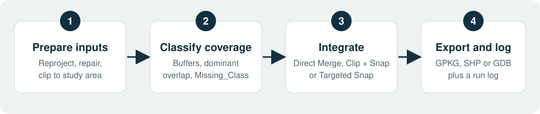
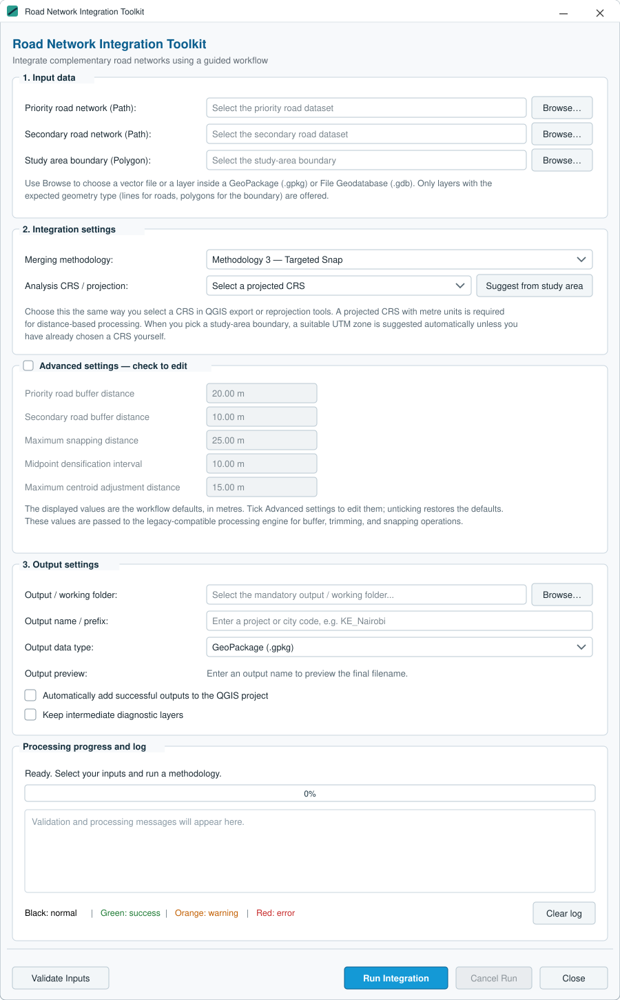
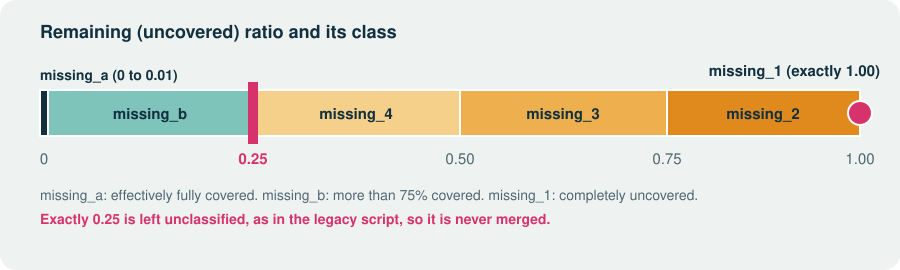
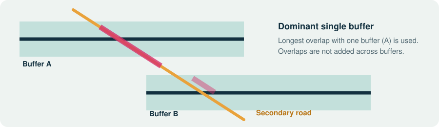
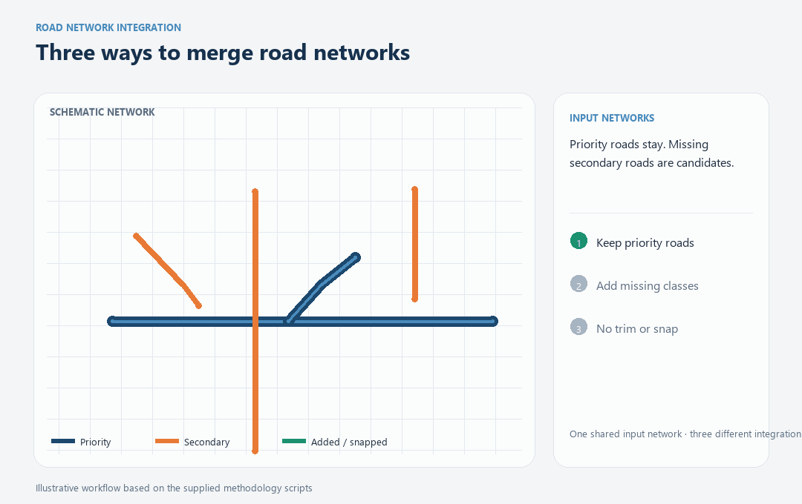
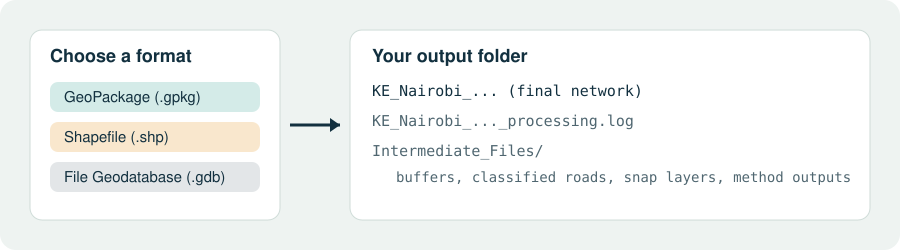
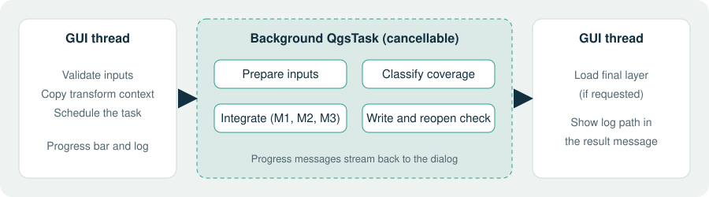

<p align="center">
  
</p>

<h1 align="center">Road Network Integration Toolkit</h1>

<p align="center">Compare networks, identify missing roads, and choose how to integrate them inside QGIS.</p>

<p align="center">
  
  
  
  
</p>

<p align="center">
  <a href="#quick-start"><b>Get started</b></a> &nbsp;·&nbsp;
  <a href="#choose-a-method">Choose a method</a> &nbsp;·&nbsp;
  <a href="#installation">Install</a> &nbsp;·&nbsp;
  <a href="#output">Output</a> &nbsp;·&nbsp;
  <a href="#troubleshooting">Troubleshoot</a>
</p>

> **In short:** choose a trusted priority network, add useful roads from a secondary network, and decide whether those roads should be snapped into place.

**Road Network Integration Toolkit** is a QGIS plugin for comparing and combining two road networks. It measures coverage, classifies the missing parts of the secondary network, and adds selected roads to the priority network. It runs inside QGIS and needs no separate GeoPandas or Shapely installation.

### At a glance

| Topic | Summary |
|---|---|
| **Three methods** | Direct Merge, Clip + Snap, and Targeted Snap |
| **Export formats** | GeoPackage, Shapefile, or File Geodatabase |
| **Compatibility** | QGIS 3.28+ (Qt5) and QGIS 4.x (Qt6) |
| **Setup** | No extra Python packages |

<details>
<summary><b>Contents</b></summary>

- [What the plugin does](#features)
- [How it works](#how-it-works)
- [Choose a method](#choose-a-method)
- [Installation](#installation)
- [Quick start](#quick-start)
- [Coverage classes](#coverage-classification)
- [Method details](#methodologies)
- [Output files](#output)
- [Tips and troubleshooting](#tips-for-good-results)
- [Compatibility and development](#compatibility)

</details>

## Features

- **Compare and classify:** coverage is measured with the legacy `Missing_Class` rules, including its exact `0.25` boundary.
- **Choose how to combine:** use one of three methods, from a direct merge to locally targeted snapping.
- **Work with confidence:** the guided dialog suggests a projected CRS, exposes editable distances, and runs as a cancellable background task.
- **Inspect the result:** export to GeoPackage, Shapefile, or File Geodatabase; optionally keep diagnostic layers and a timestamped run log.
- **Preserve source IDs:** input `fid` values are kept as `source_fid` when needed for GeoPackage compatibility.

## How it works



1. **Prepare inputs.** Both road networks are reprojected to your analysis CRS, usable geometry is repaired, and roads are clipped to the envelope of the study boundary buffered by 30 km.
2. **Classify coverage.** The plugin buffers each priority road, then gives every secondary road a `Missing_Class` from the share of its length that stays uncovered.
3. **Integrate.** Your chosen methodology merges the missing secondary roads into the priority network, with or without snapping.
4. **Export and log.** The result is written, reopened as a check, and optionally added to your project. A progress log is saved next to it.

## Installation

### From a ZIP file

1. Make sure the ZIP contains a single top-level folder named `road_network_integration_toolkit`. GitHub’s **Download ZIP** names the folder `qgis-road-network-integration-toolkit-main`, so rename it before you zip it again.
2. In QGIS, open **Plugins → Manage and Install Plugins… → Install from ZIP**.
3. Select the file and click **Install Plugin**.

### From source

Copy the `road_network_integration_toolkit` folder into your QGIS plugins directory. If an older copy is installed under a different folder name, remove it first. Then restart QGIS and enable **Road Network Integration Toolkit** under **Plugins → Manage and Install Plugins… → Installed**.

| Operating system | Plugins directory                                                          |
|------------------|----------------------------------------------------------------------------|
| Windows          | `%APPDATA%\QGIS\QGIS3\profiles\default\python\plugins`                     |
| Linux            | `~/.local/share/QGIS/QGIS3/profiles/default/python/plugins`                |
| macOS            | `~/Library/Application Support/QGIS/QGIS3/profiles/default/python/plugins` |

After installing, open the plugin from the **Plugins** menu or the toolbar icon.

## Quick start

### 1. Select your input data

| Input                             | What to choose                                         |
|-----------------------------------|--------------------------------------------------------|
| **Priority road network (Path)**  | The network you trust most. Its roads are always kept. |
| **Secondary road network (Path)** | The network that supplies the missing roads.           |
| **Study area boundary (Polygon)** | The area the integration covers.                       |

Use **Browse** to choose a vector file or a layer inside a GeoPackage (`.gpkg`) or File Geodatabase (`.gdb`). Only layers with the expected geometry type are offered: lines for roads and polygons for the boundary.

### 2. Choose the integration settings

- **Merging methodology:** Direct Merge, Clip + Snap or Targeted Snap. Targeted Snap is selected by default. See [Methodologies](#methodologies).
- **Analysis CRS / projection:** a projected CRS in metres, such as your local UTM zone. Click **Suggest from study area** to pick it automatically. A suggestion is also made when you choose a boundary, unless you have already chosen a CRS yourself.

### 3. Adjust distances (optional)

Tick **Advanced settings** to edit the distances. Unticking restores the defaults. All values are in metres.

| Setting                              | Default | Used for                                         |
|--------------------------------------|---------|--------------------------------------------------|
| Priority road buffer distance        | 20      | Buffers that define what is already covered      |
| Secondary road buffer distance       | 10      | Buffers around overlap portions in Targeted Snap |
| Maximum snapping distance            | 25      | How far an endpoint may move to join a road      |
| Midpoint densification interval      | 10      | Spacing of priority-road anchors in Clip + Snap  |
| Maximum centroid adjustment distance | 15      | Centroid-to-vertex adjustment in Targeted Snap   |

### 4. Choose the output

- **Output folder:** required. It is both your working folder and the destination.
- **Output name:** a project or city code such as `KE_Nairobi`. The dialog previews the final file name as you type.
- **Output format:** GeoPackage, Shapefile or File Geodatabase.
- **Automatically add the final output to QGIS:** off by default.
- **Keep intermediate diagnostic layers:** off by default.

### 5. Validate and run

Click **Validate Inputs** to check your choices, then **Run Integration**. Watch progress in **Processing progress and log**. You can minimise the window while it works, and **Cancel Run** stops the task at the next safe checkpoint.

## Screenshots

<p align="center">
  
</p>

<p align="center"><sub>The dialog as it first opens: inputs empty, Targeted Snap preselected, advanced distances at their defaults, and an empty log. Rendered from the plugin’s own layout and colours.</sub></p>

## Coverage classification



For each secondary road, the plugin first checks whether one individual priority buffer fully covers it. If not, it measures the overlap with every buffer it touches and takes the **largest single overlap**. Overlaps are not added together across buffers.



The **remaining ratio** is the uncovered length divided by the original length. It decides the class:

| Remaining ratio           | Class       | Meaning                                | Merged by the methodologies |
|---------------------------|-------------|----------------------------------------|-----------------------------|
| 0 to 0.01                 | `missing_a` | Effectively fully covered              | No                          |
| Above 0.01 and below 0.25 | `missing_b` | More than 75% covered                  | No                          |
| Exactly 0.25              | none        | Left unclassified by the legacy script | No                          |
| Above 0.25, up to 0.50    | `missing_4` | 25% to 50% uncovered                   | Yes                         |
| Above 0.50, up to 0.75    | `missing_3` | 50% to 75% uncovered                   | Yes                         |
| Above 0.75, below 1.0     | `missing_2` | More than 75% uncovered                | Yes                         |
| Exactly 1.0               | `missing_1` | Completely uncovered                   | Yes                         |

> **Note:** a road at exactly `0.25` belongs to no class, so it is never merged. This matches the finalized legacy script on purpose, so results line up with the original workflow.

## Choose a method

| If you need… | Choose | What to expect |
|---|---|---|
| The quickest result with original secondary geometries | **Direct Merge** | No trimming or snapping; crossing roads stay visible and gaps may remain. |
| Roads trimmed to uncovered areas and joined to nearby priority roads | **Clip + Snap** | Snaps both ends of each remaining secondary line to nearby anchors. |
| Joins focused around local overlap areas | **Targeted Snap** | Builds local targets and tries nearby points before fallback targets. |
## Methodologies



*Schematic overview; this is not a QGIS screen recording.*

[View the static comparison diagram](docs/images/methodologies.svg).

### 1. Direct Merge

**Best for:** a quick merge that stays close to the legacy workflow.

- Keeps every priority feature and adds secondary roads in `missing_1` through `missing_4`.
- Keeps full secondary-road geometry, including roads that cross or intersect the priority network.
- Does not trim or snap roads, so gaps can remain and crossings are left as they were in the input.
- Writes the legacy fields: `coverage_ratio`, `Missing_Class`, and `source`.

### 2. Clip + Snap

**Best for:** trimming secondary roads to uncovered areas and joining their ends to nearby priority roads.

1. Removes the part of each missing road inside the dissolved priority buffer.
2. Places snap anchors along priority roads at the selected densification interval.
3. Snaps both ends of each remaining secondary line to the nearest anchor within the maximum snapping distance.
4. Builds cumulative class merges and saves them to an intermediate GeoPackage.

### 3. Targeted Snap

**Best for:** keeping joins local to places where secondary roads overlap the priority network.

1. Trims missing roads against the dissolved priority buffer and buffers their overlapping portions with square end caps.
2. Clips priority roads to those local buffers to define target intersection sections.
3. Creates three local targets on each clipped priority segment: its start, end, and midpoint.
4. Tries the nearest local midpoint to the secondary segment centroid first and moves the closer secondary endpoint to it if within the maximum snapping distance. If that does not snap the segment, it tries local start/end targets; if neither local rule snaps it, it tries the nearest global targets within the same distance.
5. Adds `missing_1` roads without snapping and merges secondary roads before the priority network.

**Implementation difference:** the plugin associates each trimmed secondary road with its local square buffer before snapping. The legacy script creates a point-to-buffer join but does not attach the generated `buffer_id` to the trimmed roads. Unless the input already contains a usable `buffer_id`, its local snapping rules are skipped and it falls back to the global targets. The QGIS plugin therefore follows the intended local-first workflow more closely, and the two implementations can produce different results.

| Compare | Direct Merge | Clip + Snap | Targeted Snap |
|---|---|---|---|
| Trims secondary roads | No | Yes | Yes |
| Snaps roads | No | Both ends to nearby anchors | Nearest local target point, then fallback targets |
| Keeps crossing roads unchanged | Yes | No guarantee | No guarantee |
| Best fit | Fast, geometry-preserving merge | Broad network-wide joins | Localized joins near overlap sections |
## Output



### Final network

The result is written to your output folder as GeoPackage, Shapefile or File Geodatabase, with the name you entered. Existing files at that path are overwritten. The plugin reopens the result to confirm that QGIS can read it, and can add it to your project.

### Run log

Each run writes `<output-name>_processing.log`, with timestamps, in the output folder. Its path appears in the completion or failure message.

### Intermediate files

With **Keep intermediate diagnostic layers** ticked, the plugin keeps the working data:

| File                                                                    | Contents                                   |
|-------------------------------------------------------------------------|--------------------------------------------|
| `Intermediate_Files/<prefix>_<priority>_Road_Buffers.gpkg`              | Individual and dissolved priority buffers  |
| `<prefix>_<secondary>_Coverage_Classified.gpkg` (output folder)         | Secondary roads with their `Missing_Class` |
| `Intermediate_Files/<prefix>_Merged_<priority>_<secondary>_Method1.gpkg` | Direct Merge result                        |
| `Intermediate_Files/<prefix>_M2_Output.gpkg`                            | Clip + Snap layers, including the cumulative merges |
| `Intermediate_Files/<prefix>_M3_Output.gpkg`                            | Targeted Snap layers                       |

The `<priority>` and `<secondary>` parts are source labels the plugin works out from your input file, layer or folder names, such as `OSM` or `MS`.

### GeoPackage or Shapefile?

|                 | GeoPackage                             | Shapefile                               |
|-----------------|----------------------------------------|-----------------------------------------|
| Layers per file | Many                                   | One                                     |
| Field names     | Full length                            | Shortened to 10 characters              |
| Best for        | Everything, and the recommended choice | Sharing with software that needs `.shp` |

File Geodatabase output needs a GDAL build that can create `.gdb` (OpenFileGDB write support, GDAL 3.6 or later). The plugin checks this **before** processing starts, so you do not lose a long run to it.

## Under the hood



- **Background task:** preparation, overlay, snapping and export run as a `QgsTask`. Project access and output-layer loading stay on the GUI thread, and the worker receives a copy of the project transform context.
- **Cancel:** use **Cancel Run** or the QGIS task manager. The task stops at the next safe checkpoint.
- **Distances in metres:** if your projected CRS uses other units, distances are converted, but a local metric CRS is recommended.
- **Input attributes:** `fid`, `OBJECTID`, `ogc_fid` and `geom` values are preserved under safe names, and stale `Shape_Length` and `Shape_Area` values are not copied.
- **Unknown feature counts:** a provider that cannot report a feature count no longer stops the run.
- **Fresh form each time:** closing the dialog discards its run state. The last output folder is remembered only as the starting point for **Browse**.

## Tips for good results

- **Use a local projected CRS in metres.** The UTM zone for your study area is a good default.
- **Test on a small area first.** Compare the result with your existing workflow before running a whole country.
- **Prefer GeoPackage.** It keeps field names intact and holds every intermediate layer in one file.
- **Keep intermediates while you tune.** The buffers and classified roads show why a road was or was not merged.
- **Tune one distance at a time.** Change the snapping distance first if joins are missing or too eager.

## Troubleshooting

<details markdown="1">
<summary><b>Common problems and fixes</b></summary>

| Problem                                               | What to do                                                                                                                                                         |
|-------------------------------------------------------|--------------------------------------------------------------------------------------------------------------------------------------------------------------------|
| **Some secondary roads never appear in the result**   | Roads at exactly `0.25` remaining ratio, and classes `missing_a` and `missing_b`, are not merged by design. See [Coverage classification](#coverage-classification). |
| **File Geodatabase output is refused**                | Your GDAL build cannot create `.gdb`. Use GeoPackage, or QGIS with GDAL 3.6 or later.                                                                              |
| **Shapefile field names look shortened**              | A Shapefile limit. Use GeoPackage to keep full names.                                                                                                              |
| **My `fid` column is now `source_fid`**               | GeoPackage reserves `fid` as its unique key, so the original values are kept under `source_fid`.                                                                   |
| **Distances behave oddly**                            | Check that the analysis CRS is projected and, ideally, in metres.                                                                                                  |
| **I updated the plugin but see the old behaviour**    | Restart QGIS completely so the new code is loaded.                                                                                                                 |

If your problem is not listed, please [open an issue](https://github.com/martin-runguma/qgis-road-network-integration-toolkit/issues) and include:

- Your QGIS version and operating system
- The methodology, output format and approximate size of the study area
- The full text of the processing log

</details>

## Compatibility

| QGIS version                    | Qt          | Status    |
|---------------------------------|-------------|-----------|
| 3.28 and later (LTR and stable) | Qt5 / PyQt5 | Supported |
| 4.x (up to 4.99)                | Qt6 / PyQt6 | Supported |

Python 3.9 or later is required. All version-specific API access (enums, `QgsField` types and `QAction`) is isolated in `core/compat.py`, and `metadata.txt` declares `supportsQt6=True`.

> **Validation note:** before operational use, run the plugin in your target QGIS version on a small sample and compare it with the original Spyder scripts. QGIS/GEOS and Shapely can differ on edge-case geometry even when the workflow is equivalent.

## Release notes

<details markdown="1">
<summary><b>Version history (0.4.1 to 0.6.0)</b></summary>

**0.6.0**
- QGIS 3.28 to 4.x compatibility (Qt5 and Qt6), with `supportsQt6` declared
- Runs can be cancelled with **Cancel Run** or the QGIS task manager
- Source labels (OSM or MS) are no longer triggered by unrelated folder names in the input path
- `OBJECTID`, `ogc_fid` and `geom` inputs are preserved under safe names, and stale `Shape_Length` and `Shape_Area` are not copied
- File Geodatabase output is validated before processing starts
- Unknown provider feature counts no longer abort the run
- Faster vertex-in-buffer test in Methodology 3
- The installable ZIP has a valid folder name and no stray files

**0.5.1**
- Methodology 3 (Targeted Snap) is selected by default whenever the dialog opens or resets

**0.5.0**
- All methodologies run as a `QgsTask`, with a live progress bar, process log and per-output log file
- The dialog has a native minimise control, and the two optional checkboxes start unticked

**0.4.1**
- Input `fid` attributes are preserved as `source_fid`, which prevents GeoPackage duplicate-key failures in Methodologies 2 and 3

</details>

## Development

<details markdown="1">
<summary><b>Project layout and contributing</b></summary>

```
road_network_integration_toolkit/
├── __init__.py                          # QGIS entry point (classFactory)
├── road_network_integration_toolkit.py  # Plugin controller: menu, toolbar, dialog
├── metadata.txt                         # Plugin metadata
├── icon.png
├── gui/
│   └── main_dialog.py                   # Main dialog, layer chooser, progress log
├── core/
│   ├── compat.py                        # Qt5/Qt6 and QGIS 3/4 API differences
│   ├── configuration.py                 # Validated settings passed to the engine
│   ├── controller.py                    # Runs and reports a processing job
│   ├── background_task.py               # QgsTask wrapper
│   ├── datasource_utils.py              # Layer and datasource handling
│   ├── road_classification.py           # Missing_Class rules (no QGIS needed)
│   └── legacy_engine.py                 # Shared processing engine
├── algorithms/
│   ├── methodology_1.py                 # Direct Merge
│   ├── methodology_2.py                 # Clip + Snap
│   └── methodology_3.py                 # Targeted Snap
├── utils/
└── help/
    └── methodology_guide.md             # Longer methodology notes
```

To work on the plugin, clone this repository and link or copy it into your QGIS plugins directory as a folder named `road_network_integration_toolkit` (see [Installation](#installation)). Restart QGIS to be sure new code is running.

Contributions, bug reports and ideas are welcome. Please open an [issue](https://github.com/martin-runguma/qgis-road-network-integration-toolkit/issues) or a pull request.

</details>

## Author

**UN-Habitat Data and Analytics Unit (DAU)** · maintained by [Martin Runguma](https://github.com/martin-runguma)

## License

Released under the GNU General Public License v3.0. See the [LICENSE](LICENSE) file.
